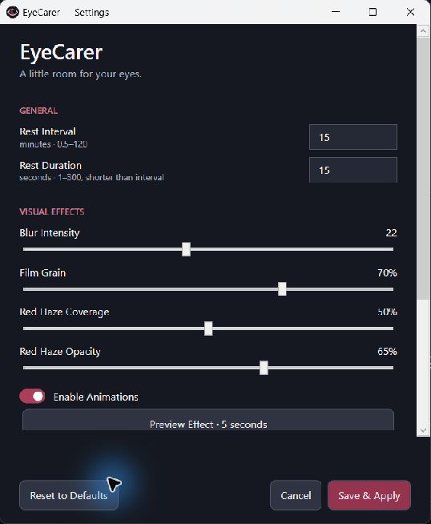

# EyeCarer

**Take a break. Give your eyes a rest.**

[Русский](README.ru.md) · [Download for Windows x64](https://github.com/GampiXs/EyeCarer/releases/latest) · [MIT license](LICENSE)

EyeCarer is a lightweight background Windows utility that reminds you to take short,
regular screen breaks. A customizable fullscreen overlay replaces notification popups:
blurred desktop, monochrome film grain, a soft red radial haze and a centered message.

## Download and start

1. Open [Releases](https://github.com/GampiXs/EyeCarer/releases/latest) and download **EyeCarer-win-x64.zip**.
2. Extract the **entire ZIP** to a stable folder you can write to, such as a folder in your user profile.
3. Run **EyeCarer.exe**. Keep every extracted file together. No Visual Studio, SDK or separate .NET runtime is required.

The first break starts after 15 minutes and lasts 15 seconds. EyeCarer starts in the
system tray, possibly among hidden icons. Running it creates its own per-user Windows
Startup shortcut by default; disable **Start with Windows** in Settings or the tray.
Do not move the folder while autostart is enabled: disable it, move the folder, then re-enable it.

The executable is **unsigned**. Windows may show a publisher or reputation warning.
Check the release source and SHA-256 checksum; this project does not ask you to disable Windows security.

## Features and controls

- Break intervals of **0.5–120 minutes**, duration **1–300 seconds**, shorter than the interval.
- Gaussian desktop blur, static monochrome grain, red haze coverage/opacity and optional animations.
- Custom center message (up to 80 characters), or hide the text.
- Dark Settings window with **Save & Apply**, **Cancel**, **Reset to Defaults** and a **5-second Preview Effect**.
- **Esc** dismisses the current overlay immediately.
- Tray menu: **Take Rest Now**, **Settings...**, **Pause for 1 Hour**, **Resume**, **Start with Windows**, **Exit EyeCarer**.
- Double-click the tray icon to open Settings. Closing Settings leaves reminders running.
- One instance per Windows session; sleep/resume and unlock reset the interval without replaying missed breaks.

Save applies new settings without restarting and starts a fresh interval. Preview uses
unsaved visual values without saving or changing the schedule. Reset only changes the
fields until saved. Manual rest does not shift automatic deadlines. A paused app still
allows manual rest; after the hour, a new full interval begins. Resume starts a fresh interval.

Separate overlay windows are implemented for each monitor using physical bounds and
PerMonitorV2 DPI awareness. **Multiple monitors and mixed DPI are not hardware-verified.**
Desktop interaction is intercepted during a break; system shortcuts are not hooked.



## Configuration

The working **config.json** lives next to the executable. Use Settings, or exit the app
before editing JSON. A writeable installation folder is required. Atomic saves keep
**config.json.bak**; unknown fields are preserved. Missing or malformed JSON falls back
to safe defaults. The build packages defaults from [config.example.json](config.example.json),
never your local runtime settings.

| Setting | Default |
|---|---|
| IntervalSeconds / DurationSeconds | 900 / 15 |
| BlurRadius | 22 (0–50) |
| GrainStrength | 0.70 (0–1) |
| HazeCoverage / HazeOpacity | 0.50 / 0.65 (0–1) |
| ShowCenterText / CenterText | true / Take rest |
| EnableAnimations / StartWithWindows | true / true |
| StartImmediately | false (advanced JSON option) |

## Build from source

Verified on **Windows 11 x64**, using **.NET SDK 8** and WPF/Windows Forms NotifyIcon.
Windows 10 is not validated for this release. Git and network access for the initial
Microsoft runtime-pack restore are required. There are no third-party application packages.

```powershell
 git clone https://github.com/GampiXs/EyeCarer.git
 cd EyeCarer
 dotnet build src/EyeCarer/EyeCarer.csproj -c Release
 dotnet run --project tests/EyeCarer.Checks -c Release
 dotnet publish src/EyeCarer/EyeCarer.csproj -c Release -r win-x64 --self-contained true -p:DebugType=None -p:DebugSymbols=false -o publish
```

Output: **publish/EyeCarer.exe**, with its supporting files. GitHub Actions builds and
runs the console checks on a Windows runner; it does not simulate desktop interactions.

`scripts/Install.ps1` is a developer convenience requiring the SDK: it stops only the
instance from this checkout's publish folder, publishes there, preserves existing JSON,
maintains the selected per-user Startup state and launches the app. It creates no service,
registry autorun entry or scheduled task and needs no administrator rights.

For a source installation, `scripts/Uninstall.ps1` stops that installation and removes
its matching Startup shortcut while retaining source, binaries and settings. For the
release ZIP, disable **Start with Windows**, choose **Exit EyeCarer**, then delete the
extracted folder yourself. Preserve config.json separately if you want to keep settings.

## Privacy and security

The reviewed capture path takes a **static desktop screenshot into memory** before
showing any overlays. It blurs that image locally and releases the image references
when the windows close. **The application does not write captures to disk, send them
over the network, or include analytics/advertising.** There is no application HTTP client
or remote service. Local named-pipe commands are restricted to the current user.
Build tools and GitHub downloads use the network; these are separate from runtime behavior.

Settings (including your custom message), backups and optional logs are local files.
Error logs contain operation names, exception types/codes and timestamps, not screenshots
or exception messages. Opt-in diagnostics record break timing. Review files before sharing.
Normal process/OS memory and crash-dump policies are outside the app's control.

No personal desktop screenshots are included in this repository. Original icon geometry
is generated by scripts/Generate-Icon.ps1. App code/assets are MIT; the self-contained
package also carries the bundled Microsoft runtime license and third-party notices.

## Limitations and validation

Automated checks cover scheduling, range validation, malformed JSON, unknown-field
preservation and atomic backups. Local interactive checks covered Settings, preview,
manual/automatic rest, Esc, pause/resume, singleton behavior and exit. Multi-monitor,
physical sleep/resume, multiple DPI scales, a fresh Windows login and long-duration
soak tests remain unverified. Screenshot capture failure falls back to a dark background.
WPF graphics allocation grows while overlays are active; no constant rendering loop
or screenshot capture runs between breaks.

## Contributing and license

See [CONTRIBUTING.md](CONTRIBUTING.md), [SECURITY.md](SECURITY.md) and [CHANGELOG.md](CHANGELOG.md).
EyeCarer is available under the [MIT License](LICENSE).

**Health disclaimer:** EyeCarer is a break reminder, not a medical device. Blur, red haze
and grain are visual choices, not proven treatments or protection against vision loss.
