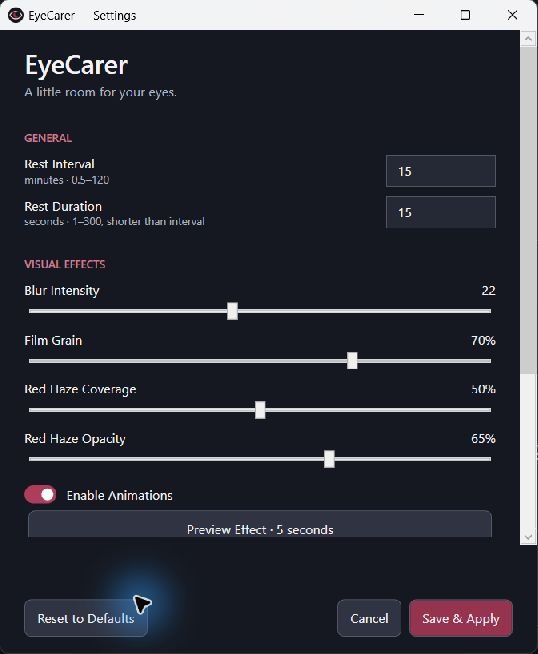

# EyeCarer

**Сделайте перерыв. Дайте глазам отдохнуть.**

[English](README.md) · [Скачать Windows x64](https://github.com/GampiXs/EyeCarer/releases/latest) · [MIT](LICENSE)

EyeCarer работает в фоне и напоминает о коротком отдыхе полноэкранным эффектом:
размытый снимок рабочего стола, монохромное зерно, мягкая красная дымка и надпись.

## Установка и использование

1. На странице Releases скачайте **EyeCarer-win-x64.zip**.
2. Распакуйте весь архив в постоянную папку с правами записи текущего пользователя.
3. Запустите **EyeCarer.exe**. Все файлы должны оставаться вместе; установка .NET Runtime,
   SDK или Visual Studio не требуется.

Первый перерыв — через 15 минут, длительность — 15 секунд. Значок находится в трее,
возможно среди скрытых значков. По умолчанию запуск создаёт пользовательский ярлык
автозагрузки Windows. Его можно отключить в Settings или меню трея.
Двоичный файл не подписан; Windows может показать предупреждение о неизвестном издателе.
Проверяйте источник и SHA-256, не отключайте защиту Windows.

Двойной клик по значку или **Settings...** открывает настройки. Можно изменить интервал
(0,5–120 минут), длительность (1–300 секунд, меньше интервала), Blur, Grain, покрытие и
непрозрачность дымки, анимации и текст (до 80 символов).
**Save & Apply** применяет изменения без перезапуска и начинает новый интервал.
**Cancel** отбрасывает черновик, **Reset to Defaults** меняет поля до сохранения.
**Preview Effect** показывает несохранённые визуальные параметры на 5 секунд, не меняя
JSON и расписание. **Esc** сразу закрывает эффект.

Меню трея: **Take Rest Now**, **Settings...**, **Pause for 1 Hour**, **Resume**,
**Start with Windows**, **Exit EyeCarer**. Пауза не запрещает ручной отдых; после часа
начинается полный интервал. Resume начинает новый интервал. Закрытие Settings
не завершает приложение. Повторный запуск не создаёт вторую копию в том же сеансе.



## Настройки, автозагрузка и удаление

Рабочий **config.json** находится рядом с EXE. Для ручного редактирования завершите
приложение. Папка должна разрешать запись. Сохранение атомарное, предыдущий файл остаётся
в **config.json.bak**; неизвестные поля сохраняются. Повреждённый или отсутствующий JSON
заменяется безопасными значениями в памяти. Исходные значения — в **config.example.json**:
900/15 секунд, Blur 22, Grain 0.70, Haze Coverage 0.50, Haze Opacity 0.65, Take rest,
текст/анимации/автозагрузка включены, StartImmediately=false. Подробнее — в English README.

Автозагрузка — собственный ярлык в пользовательской Startup, без службы, системного
задания и прав администратора. Перед переносом папки отключите автозагрузку, после
переноса включите снова. Для удаления ZIP-версии отключите Start with Windows,
выберите Exit EyeCarer и удалите распакованную папку. При необходимости сохраните JSON.

## Сборка

Проверено на **Windows 11 x64**, **.NET SDK 8**, C#/WPF и стандартном NotifyIcon.
Windows 10, несколько мониторов и смешанные DPI физически не проверены.

```powershell
 git clone https://github.com/GampiXs/EyeCarer.git
 cd EyeCarer
 dotnet build src/EyeCarer/EyeCarer.csproj -c Release
 dotnet run --project tests/EyeCarer.Checks -c Release
 dotnet publish src/EyeCarer/EyeCarer.csproj -c Release -r win-x64 --self-contained true -p:DebugType=None -p:DebugSymbols=false -o publish
```

Для первого восстановления Microsoft runtime packs нужен интернет. Внешних прикладных
NuGet-зависимостей нет. Результат — publish/EyeCarer.exe со всеми файлами публикации.
GitHub Actions собирает проект и запускает консольные проверки на Windows.

**scripts/Install.ps1** предназначен для разработчиков: требует SDK, останавливает только
экземпляр из publish текущего проекта, собирает его, сохраняет настройки и выбор автозагрузки,
затем запускает. **scripts/Uninstall.ps1** останавливает эту установку, удаляет только её
ярлык Startup и сохраняет файлы проекта. Для ZIP-версии скрипты не нужны.

## Приватность и ограничения

По проверенному коду снимки экрана создаются локально **только в памяти**, до показа окон,
и используются как неподвижная подложка эффекта. Приложение не записывает снимки на диск
и не отправляет их в сеть; аналитики, рекламы, HTTP-клиента и облачных сервисов нет.
Локальные команды через named pipe доступны текущему пользователю. Инструменты сборки
и загрузки GitHub используют сеть отдельно от приложения.

JSON, его резервные копии и логи локальны. JSON может содержать ваш текст напоминания.
Ошибки логируются как название операции, тип/код и время, без снимков и текста исключения.
Диагностика по запросу сохраняет время перерывов. Перед передачей файлов проверяйте их.
Политика системной памяти и crash dumps Windows не контролируется приложением.

Окна для каждого монитора и обработчики сна/разблокировки реализованы, однако несколько
мониторов, различные DPI, физический sleep/resume, новый вход в Windows и многочасовые
тесты не подтверждены. При ошибке захвата используется тёмный фон. Между перерывами
нет постоянного захвата или цикла отрисовки. WPF временно увеличивает расход графической памяти.
Личные скриншоты не публикуются. Иконка создана программно в этом проекте.

## Участие и лицензия

[CONTRIBUTING.md](CONTRIBUTING.md) · [SECURITY.md](SECURITY.md) · [CHANGELOG.md](CHANGELOG.md).
Код и оригинальные ресурсы — [MIT](LICENSE). ZIP также содержит лицензии и уведомления
Microsoft runtime.

EyeCarer — напоминание об отдыхе, а не медицинское устройство. Размытие, зерно и красная
дымка — визуальные эффекты, а не доказанное лечение или защита от ухудшения зрения.
